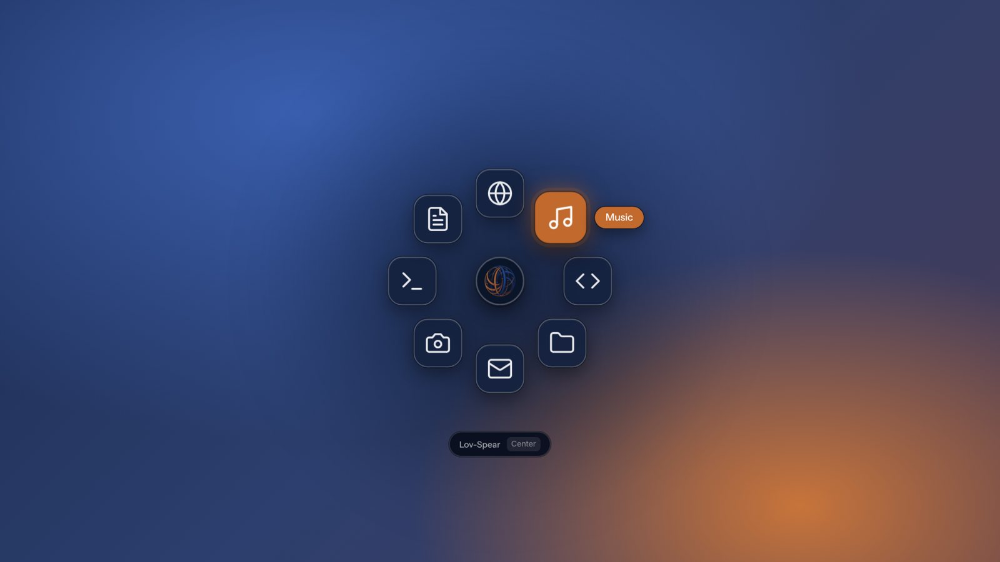
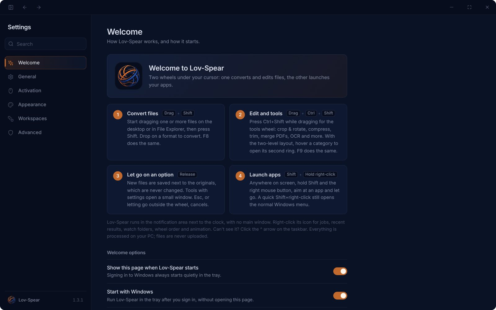

# Lov-Spear

**Drag. Drop. Convert. Launch.**

Two wheels right under your cursor for Windows: one converts and edits any file you drag, the other opens your apps from anywhere.

[Microsoft Store](https://apps.microsoft.com/detail/9PDZ571BS3JK) · [Download](../../releases/latest) · [Website](https://xtremislv.github.io/lov-spear/) · [Privacy](privacy.html)

## How it works

| Gesture | What happens |
| --- | --- |
| Drag files + **Shift** (or F8) | **Convert:** a wheel of formats appears; drop on one |
| Drag files + **Ctrl+Shift** (or F9) | **Edit:** crop, compress, trim, merge PDFs, OCR and 40+ tools |
| **Shift + hold right-click** anywhere | **Launch:** aim at an app, folder or website and let go |

Lov-Spear lives in the system tray with no main window. New files are saved next to the originals, which are never changed.

## Features

- **Hundreds of formats**: images, video, audio, documents, archives, e-books, fonts, subtitles, 3D models, CAD and data files
- **48 editing tools** without opening an editor
- **Launcher workspaces** for work, gaming or streaming, switched with a number key
- **Your animation**: Citrus spin, Bloom, Cascade or Pop, with speed and logo-spin options
- **Watch folders**, background jobs with pause/cancel, and a command line
- **Midnight navy, Light or Match-Windows** themes; English, 简体中文, العربية
- **Private**: everything runs on your PC; no account, ads or telemetry

## Install

- **Microsoft Store** (recommended; updates itself): [Lov-Spear](https://apps.microsoft.com/detail/9PDZ571BS3JK)
- **Installer / portable ZIP**: from [Releases](../../releases/latest). These builds are unsigned, so Windows SmartScreen may ask you to confirm: **More info → Run anyway**.

Windows 10 (1809+) or 11, x64.

## Privacy

Your files never leave your PC. The only network access is downloading a website's icon when you add a website shortcut to the launcher. See the [privacy policy](privacy.html).

## Credits and licences

Lov-Spear is built on two open-source projects:

- [ZestDrop](https://github.com/Maxaccurate/ZestDrop) by Max Chen: file conversion wheels (MIT)
- [Rovyl](https://github.com/HenryCauan/rovyl) by Henry Cauan: radial launcher (GPL-3.0-or-later)

The launcher in Lov-Spear is a modified Rovyl and is distributed under the GPL-3.0. The complete set of Lov-Spear changes
to both projects is in [`source/`](source/), with instructions to rebuild.

© 2026 lovy verma
